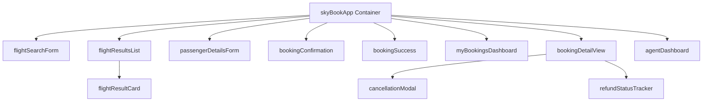

# SkyBook Pro - Architecture

## Backend Layer (Apex)

The backend layer is complete and handles airport searches, flight queries, booking creation, pricing checks, and email notifications.

Key classes reused:
* `DuffelAirportService`: Performs airport autocomplete search callouts.
* `DuffelFlightSearchService`: Contacts Duffel for real-time flight options.
* `DuffelFlightPricingService`: Reconfirms pricing before booking creation.
* `BookingService`: Creates/saves bookings, passengers, segments, and processes status changes.
* `BookingSearchService`: Fetches current travel agent's bookings, details, and aggregated statistics.
* `FlightService`: Manages flight record queries and persistence.

## Frontend Layer (LWC)

The frontend is migrated from Visualforce pages to Lightning Web Components.

* Communication between side-by-side dashboard components is handled via the Lightning Message Service channel: `SkyBook_Channel__c`.
* Shared utilities (`skyBookUtils`) provide date/currency helpers.
