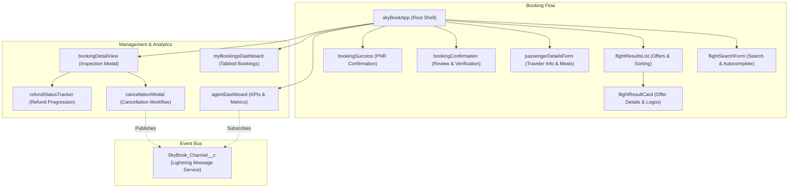

# ✈️ SkyBook Pro

> **Enterprise-Grade Airline Flight Search & Reservation System on the Salesforce Platform**

[](https://developer.salesforce.com/tools/vscode/)
[](https://developer.salesforce.com/docs/component-library/overview/components)
[](https://developer.salesforce.com/docs/atlas.en-us.apexcode.meta/apexcode/)
[](https://duffel.com/docs/api)
[](https://github.com/prettier/prettier)
[](https://jestjs.io/)

---

## 📖 Overview

**SkyBook Pro** is a comprehensive, production-ready flight search, booking, and reservation management platform built natively on **Salesforce**. Powered by the **Duffel Flights API**, it enables corporate travel agents and flight operations coordinators to discover real-time flight offers, validate multi-passenger itineraries, issue reservations with unique PNR tracking, and orchestrate post-booking lifecycles (cancellations, refunds, and automated departure notifications).

Initially architected with Visualforce pages, SkyBook Pro is now fully modernized with a high-performance **Lightning Web Components (LWC)** single-page experience, leveraging **Lightning Message Service (LMS)** for decoupled cross-component communication, **Lightning Design System (SLDS)** styling, and enterprise Apex asynchronous processing.

---

## ✨ Key Features

### 🔍 Real-Time Flight Search & Discovery
- **Live Duffel API Integration**: Performs live searches across hundreds of airlines using Salesforce Named Credentials (`Duffel_Credential`).
- **Airport Auto-Complete**: Instant search and IATA code lookup for origin and destination airports.
- **Multi-Cabin Support**: Search Economy, Premium Economy, Business, and First Class cabins.
- **Dynamic Sorting & Filtering**: Sort offers by Price (Low to High, High to Low), Duration, and Departure Time.
- **Carrier Branding**: Dynamic airline logo rendering with fallback iconography.

### 👥 Traveler & Itinerary Management
- **Multi-Passenger Configuration**: Dynamic form generation supporting multiple adults, children, and infants.
- **Multi-Select Meal Preferences**: Picklist support for `Vegetarian`, `Non-Veg`, `Vegan`, and `Jain` options.
- **Real-Time Validation & Highlighting**: Exhaustive per-traveler field validation with dynamic SLDS error banners and border highlighting.
- **Pre-Booking Pricing Reconfirmation**: Guarantees fare accuracy by re-verifying live prices via `DuffelFlightPricingService` before booking commitment.

### 📋 Booking Management & Dashboards
- **My Bookings Portal**: Filter confirmed bookings across **All**, **Upcoming**, **Past**, and **Cancelled** categories with live database queries.
- **Booking Detail View**: Drill down into multi-leg flight segments, passenger allocations, meal choices, and PNR details.
- **Agent Metrics Dashboard**: Real-time agent performance KPIs:
  - *Today's Bookings*
  - *Today's Confirmed Revenue*
  - *Pending Group Approvals*
  - *Active Cancellation Cases*
  - *Recent Bookings Feed*

### 🔄 Cancellations & Automated Refunds
- **Self-Service Cancellation Modal**: Integrated workflow with reason tracking and automated penalty deductions.
- **Refund Status Tracker**: Visual progression milestones tracking refund stages from `Initiated` to `Processing` and `Refunded`.
- **Reactive UI Synchronization**: Real-time cross-component updates powered by the `SkyBook_Channel__c` Lightning Message Channel.

### ⚡ Asynchronous Processing & Notifications
- **Departure Reminders**: Schedulable daily job (`DailyDepartureReminderScheduler`) queuing automated reminders (`DepartureReminderQueueable`).
- **Automated Archiving**: Batch Apex job (`BookingArchiveBatch`) archiving stale and legacy bookings.
- **Email Confirmations**: Asynchronous `@future` service (`BookingEmailFutureService`) sending automated booking confirmation summaries.

---

## 🏛️ System Architecture

### Component Hierarchy (LWC)



---

## 🗄️ Data Model

| Custom Object | API Name | Description |
| :--- | :--- | :--- |
| **Booking** | `Booking__c` | Primary booking record tracking PNR, booking status, total amount, agent user, and cabin class. |
| **Flight** | `Flight__c` | Individual flight schedules including airline name, origin/destination IATA codes, and departure/arrival timestamps. |
| **Flight Segment** | `Flight_Segment__c` | Individual segments of multi-leg journeys, capturing flight numbers, operating carriers, and segment duration. |
| **Passenger Detail** | `Passenger_Detail__c` | Passenger demographic details, ticket numbers, assigned seats, and multi-select meal preferences. |
| **Refund** | `Refund__c` | Tracks refund requests, amounts, cancellation penalty fees, and payment status lifecycles. |

---

## 💻 Tech Stack

- **Platform**: Salesforce DX (API v66.0)
- **Backend**: Apex (Triggers, Services, Batch Apex, Schedulable, Queueable, Future Methods)
- **Frontend**: Lightning Web Components (LWC), Lightning Design System (SLDS), Visualforce
- **Messaging**: Lightning Message Service (LMS)
- **External API**: Duffel Flights API (REST / JSON)
- **Security & Integrations**: Named Credentials (`Duffel_Credential`), External Credentials, CSP Trusted Sites
- **Testing**: Apex Unit Tests (106+ tests, 100% pass rate), Jest for LWC
- **Tooling**: Salesforce CLI (`sf`), Node.js, Prettier with Apex/XML plugins, ESLint, Husky

---

## 📁 Repository Structure

```text
SkyBookPro/
├── force-app/main/default/
│   ├── classes/               # Apex Controllers, Services, Wrappers, Batch & Schedulers
│   ├── triggers/              # BookingTrigger & Domain Handlers
│   ├── lwc/                   # Lightning Web Components (13 modular components)
│   ├── messageChannels/       # SkyBook_Channel Lightning Message Channel
│   ├── namedCredentials/      # Duffel API Named Credentials
│   ├── objects/               # Schema definitions for Booking, Flight, Passenger, Refund
│   ├── pages/                 # Visualforce Pages (Legacy UI & Administrative Views)
│   ├── approvalProcesses/     # Approval workflows for group bookings & refunds
│   ├── flexipages/            # Lightning App Pages
│   └── permissionsets/        # Security and access permission sets
├── scripts/
│   ├── apex/                  # Anonymous Apex execution scripts
│   └── soql/                  # Common SOQL diagnostic queries
├── ARCHITECTURE.md            # Technical Architecture and Design Specs
├── CHANGELOG.md               # Version History and Sprint Release Notes
├── sfdx-project.json          # Salesforce DX configuration
└── package.json               # Development dependencies and test runner scripts
```

---

## 🚀 Getting Started

### Prerequisites

1. Install [Salesforce CLI (`sf`)](https://developer.salesforce.com/tools/salesforcecli).
2. Install [Node.js (v18+)](https://nodejs.org/) and `npm`.
3. Install [VS Code](https://code.visualstudio.com/) with the [Salesforce Extension Pack](https://marketplace.visualstudio.com/items?itemName=salesforce.salesforcedx-vscode).
4. A Duffel API token (sign up at [duffel.com](https://duffel.com)).

### 1. Clone the Repository

```bash
git clone https://github.com/Farhan-akhtar-github/Sky-book-pro.git
cd Sky-book-pro
```

### 2. Install Dependencies

```bash
npm install
```

### 3. Authenticate with your Salesforce Org

```bash
# Log in to your Developer Edition or Scratch Org
sf org login web -d -a skybook-org
```

### 4. Deploy Metadata

```bash
# Deploy all source to the target org
sf project deploy start --target-org skybook-org
```

### 5. Configure Named Credential for Duffel

1. Navigate to **Setup > Named Credentials**.
2. Update `Duffel_Credential` with your Duffel API access token in the Authentication Header (`Bearer <YOUR_DUFFEL_TOKEN>`).
3. Verify that the CSP Trusted Site for Duffel is active under **Setup > CSP Trusted Sites**.

### 6. Assign Permission Sets

```bash
sf org assign permset -n SkyBook_Agent_Permissions -o skybook-org
```

---

## 🧪 Testing & Code Quality

### Apex Unit Tests

Run the complete test suite across all services, controllers, and batch jobs:

```bash
# Run all Apex tests with code coverage
sf apex run test --code-coverage --result-format human -o skybook-org
```

### LWC Jest Unit Tests

Run unit tests for Lightning Web Components:

```bash
# Run LWC Jest suite
npm run test:unit

# Run Jest tests with code coverage report
npm run test:unit:coverage
```

### Linting & Formatting

SkyBook Pro adheres to strict SLDS and Apex style conventions via Prettier and ESLint:

```bash
# Check code formatting
npm run prettier:verify

# Automatically format code
npm run prettier

# Lint LWC code
npm run lint
```

---

## 📄 License

This project is licensed under the [MIT License](LICENSE) — see the LICENSE file for details.

---

## 👨‍💻 Author

Developed with ❤️ by [Farhan Akhtar](https://github.com/Farhan-akhtar-github).
